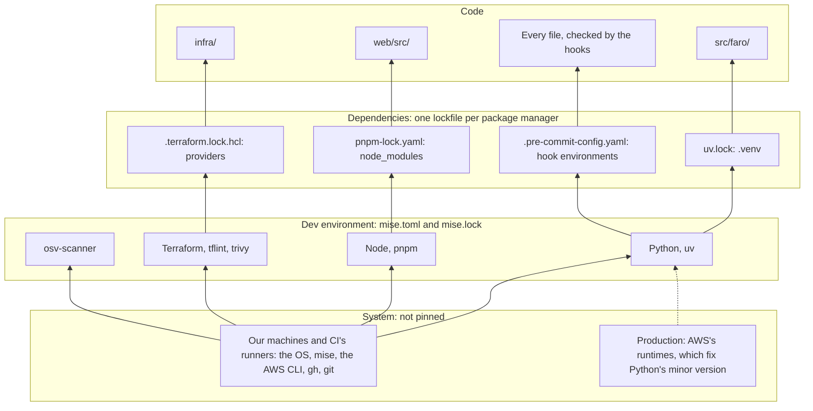

# ADR-0008: Pin the toolchain by layer, with mise for the dev environment

## Status

Accepted (2026-10-31).

Amended as built, each correction applied in the section it names:

- 2026-10-31: jq joins the system layer ([Decision](#decision)): the deploy's scripts read Terraform's outputs with it, since no Python runs with the deploy role ([ADR-0009](0009-release-checked-deploys.md)).
- 2026-11-01: osv-scanner joins the dev environment, and pnpm no longer checks its own version against `packageManager`, which kept the lockfile in two documents that hid it from GitHub ([Decision](#decision)); Dependabot reads the composite action ([Consequences](#consequences)) ([ADR-0010](0010-gate-merges-on-advisories.md)).

## Context

Every tool that builds, checks, or deploys Faro has a version, and so far each version has lived wherever its tool happened to look. Five forces make that worth deciding:

- **The versions live in several places, and nothing keeps them in step.** Python's is in `.python-version` (`3.13`, so the patch is whatever uv installs), Node's in `.nvmrc`, pnpm's in `packageManager` in `web/package.json`, Terraform's in `.terraform-version` and in both workflows' `TF_VERSION`, and tflint's and trivy's only in the quality gates' `env` block. uv has only a floor (`required-version = ">=0.13"`), so CI installs the newest uv it allows. They have drifted before: until [#95](https://github.com/gafnts/factored-hackathon-2026-faro/pull/95), `uv.lock` was written by a uv eight months older than CI's and Dependabot's, so every Dependabot update rewrote the lock's format, and two security fixes were redone by hand.
- **What a machine runs depends on what's installed, not on what's declared.** On 2026-10-31, CI's quality gates ran Python 3.13.18, downloaded by their uv, while our development machine ran 3.13.12. On the same machine, a non-interactive shell found Node 22 instead of `.nvmrc`'s 24.21.0, a second uv (0.6.14) sat on the PATH, and tflint and trivy matched CI only because they had been installed recently.
- **Nothing bumps these versions for us.** Dependabot updates the lockfiles, the hooks, the GitHub Actions, and the AWS provider, but none of the files above. Each is bumped by hand, and on 2026-10-31 Terraform (1.16.4 against 1.17.1), tflint (0.64.0 against 0.65.0), and trivy (0.74.0 against 0.76.1) were behind.
- **Production fixes Python's minor version, and nothing finer.** The Lambdas run AWS's `python3.13` runtime on arm64 and the AgentCore Runtime runs `PYTHON_3_13`. AWS applies patch releases on its own, and `make build` packages the zips for `aarch64-manylinux2014` and Python 3.13.
- **The tools run where the credentials are.** The deploy workflow's Apply job holds the deploy role and installs uv, Terraform, Node, and pnpm through four setup actions. Its pnpm then downloads the pinned pnpm at run time, checked by nothing in the repository.

Setup must be reproducible (OPS-07), and the risks we leave must be written down (OPS-11). We also mean these conventions to carry over to projects like this one, including private repositories on a personal GitHub account, where GitHub's paid security products aren't available.

## Decision

Treat the toolchain as layers, pin each layer in one file, and let whatever installs a layer read that file. Each layer stands on the one below it; the dotted arrow is a constraint, not an install:

| Layer | What it holds | Where its versions live | What installs it |
|---|---|---|---|
| Dependencies | The Python packages and the Python-based tools (ruff, mypy, pre-commit, zizmor); the web app's packages and tools; Terraform's providers; tflint's AWS ruleset; the hooks pre-commit fetches | `uv.lock`; `web/pnpm-lock.yaml`; each root's `.terraform.lock.hcl`; `.tflint.hcl`; `.pre-commit-config.yaml`, by commit SHA | uv, pnpm, `terraform init`, `tflint --init`, pre-commit |
| Dev environment | Python, uv, Node, pnpm, Terraform, tflint, trivy, osv-scanner | `mise.toml`, with `mise.lock` | mise |
| System | The OS, mise itself, the AWS CLI, the GitHub CLI, jq, direnv, git; in production, AWS's runtimes | Not pinned: any recent version works | Each of us, or AWS |

A tool belongs to the dev environment when a different version could change our lockfiles, our results, or a deploy; otherwise it belongs to the system. CI is a second machine, not a layer: it rebuilds the same layers from the same files.

In practice:

- **`mise.toml` holds exact versions**, and `mise.lock` records each one's download URL and checksum for Linux x64 (CI) and macOS arm64 (our machines), with provenance (GitHub attestations, cosign) checked when the lock is written. `locked = true` makes an install that doesn't match the lock fail instead of looking the version up again, and `minimum_release_age = "7d"` gives mise the week-old rule that `uv.lock` and `pnpm-lock.yaml` already follow. `.python-version`, `.nvmrc`, and `.terraform-version` go.
- **uv uses mise's Python.** `python-preference = "system"` in `pyproject.toml` makes uv take the Python on the PATH, which is mise's, instead of one it downloads. The pinned patch is 3.13.17.
- **pnpm's pin stays in `packageManager`.** mise installs that version as the launcher, so the pnpm that runs is the one `mise.lock` checked, and nothing is downloaded at run time. A test keeps the two equal. pnpm itself doesn't check the version (`pmOnFail: ignore`): the record of that check is a second document in the lockfile, which hides the whole file from GitHub's dependency graph ([ADR-0010](0010-gate-merges-on-advisories.md)).
- **Ranges stay as guards.** `requires-python`, `engines`, each root's `required_version`, and uv's `required-version` pin nothing; they make a wrong install fail fast, and every pin must fall inside them. Python's minor version moves only with AWS's runtimes.
- **CI installs the toolchain in one place.** Every job calls a composite action, `.github/actions/toolchain`, which runs `jdx/mise-action` at a pinned mise release a week old (the one version `mise.toml` can't hold) and restores uv's and pnpm's caches. Jobs call it with `uses: $/...`, which loads it from the commit being run instead of the working tree.
- **Hooks are pinned by commit SHA**, with the `# frozen:` comment Dependabot reads and rewrites.
- **Bumps.** Dependabot keeps the dependency layer current, except tflint's AWS ruleset in `.tflint.hcl`. That ruleset, the dev environment, and the mise release in the composite action are bumped by hand in the quarterly round; for the dev environment, `mise outdated --bump` lists what's newer and at least a week old, and each bump stays inside its guard.

## Alternatives considered

**Native version files, plus a check that they agree.** Keep `.python-version`, `.nvmrc`, and `.terraform-version`, have the workflows read them, and fail CI when they disagree. uv, tflint, and trivy have no such file, so the check would have to read workflows and docs. It checks what's declared, not what's installed, so it wouldn't have caught Node 22 or the stray uv. Dependabot doesn't update these files either, so the option saves no bump.

**`.tool-versions`, asdf's format.** mise, asdf, setup-uv, and setup-node read it, but the Terraform, tflint, and trivy actions don't, it has no lock with checksums, and Dependabot doesn't read it.

**A dev container.** It would pin the system layer too, which this decision leaves alone. But production isn't a container (it's AWS's managed runtimes), every contributor would need Docker, CI would build or pull an image for every job, and the image would be one more thing to keep current.

**Nix.** It pins every layer reproducibly, at the cost of a toolchain much larger than the tools it pins, and a steep path for anyone reading or forking the repository.

**pnpm left out of mise.** One number instead of two, with any recent pnpm installed by hand. In CI, the setup action's pnpm would keep downloading the pinned one at run time, checked by nothing in the repository.

**Renovate, which updates `mise.toml`.** It would take over the hand bumps, at the cost of a second update bot beside Dependabot, whose groups, cooldowns, and security updates we've already tuned. Dependabot's own support for mise is an open pull request; if it ships, it takes over these bumps.

## Consequences

Positive:
- A bump changes one line in one file, plus the lock, and our machines and CI install the same versions, checked against the same checksums. Python's patch no longer depends on which uv is installed.
- Setup starts with installing mise and running `mise install`, instead of installing six tools one by one.
- In CI, one action replaces six setup actions. The Apply job, which holds the deploy role, runs fewer third-party actions (toward [#111](https://github.com/gafnts/factored-hackathon-2026-faro/issues/111)) and downloads no tool unchecked.
- The week-old rule applies at every layer.

Negative:
- Dependabot doesn't update `mise.toml`, so the dev environment and the mise release in CI are bumped by hand, quarterly.
- pnpm's version is written twice, in `packageManager` and in `mise.toml`; a test keeps them equal.
- mise becomes trusted code on our machines and in every CI job, the Apply job included. It releases almost daily, often with lockfile changes, so CI pins a release a week old, and `mise.toml` sets the oldest release it accepts (`min_version`).
- Contributors activate mise in their shell, or put its shims on the PATH, and trust the repository's config once (`mise trust`). Without mise, uv takes whichever Python 3.13 is on the PATH, so that machine isn't pinned to the patch.
- actionlint doesn't know the `$/` syntax yet, so its hook ignores that one message until it does.
- Dependabot scans `.github/workflows` and a root `action.yml` only, so `.github/dependabot.yml` lists the composite action's directory too, or its pins would go stale.
