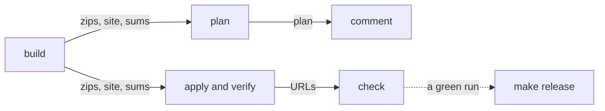

# ADR-0009: Release only checked deploys of credential-free builds

## Status

Accepted (2026-10-31).

## Context

`deploy-prototype.yml` does everything a release needs in one job, with one set of credentials, and stops short of the end. Four forces make that worth deciding:

- **Build code runs with the deploy role.** In the Apply job, `configure-aws-credentials` runs before `make build` and before the web app's install and build, so Vite, its plugins, and every package they load run with the deploy role in the environment ([#111](https://github.com/gafnts/factored-hackathon-2026-faro/issues/111)). The Plan job builds the same way under the read-only plan role, and posts its comment through a third-party action after assuming it. The role can't touch IAM or another environment, but the Lambdas' code and the site are exactly what an attacker would want to change. Reordering the steps wouldn't help: `id-token: write` is granted to a job, not a step, so any step in the job can request a token and assume the role itself.
- **Nothing checks a deploy.** The Apply job ends once the site is uploaded ([#114](https://github.com/gafnts/factored-hackathon-2026-faro/issues/114)). We check `prototype` by hand: the browser and integration suites (about 16 minutes, run with an administrator's keys and the personas from the local snapshot), and the Runtime's stamp, read from a zip downloaded from the artifacts bucket.
- **Nothing names a version.** `pyproject.toml` has said `0.1.0` since the scaffold, there are no tags, and the changelog counts promotions ([#125](https://github.com/gafnts/factored-hackathon-2026-faro/issues/125)). Each heading named its promotion's PR, so the PR that dated the changelog had to merge before the promotion's ([#131](https://github.com/gafnts/factored-hackathon-2026-faro/pull/131) before [#130](https://github.com/gafnts/factored-hackathon-2026-faro/pull/130)), and a promotion's diff grew after its review began.
- **A build now has an identity of its own.** Since [ADR-0004](0004-agent-architecture-on-agentcore.md)'s amendment of 2026-10-31, the same commit builds the same zips from any checkout, each zip holds only what its functions run, and the Runtime's stamp is the last commit that changed its code. A zip's SHA-256 says what runs, and a promotion that changes no code changes no zip, so a name can sit on top of a build without moving it.

The setup must be reproducible and versioned (OPS-07), the deployed site must work from the submitted link (OPS-12), the stack must be monitored (OPS-03), who may change it must be explained (OPS-09), and the risks we leave must be written down (OPS-11). As with [ADR-0008](0008-pin-toolchain-by-layer.md), we mean this to carry over to projects on the same stack.

## Decision

Separate the four steps of a release (building, deploying, checking, and naming) and give each one only what it needs:

| Step | Where | Holds | Runs |
|---|---|---|---|
| Build | `build` job | No credentials: `contents: read`, no `id-token` | `make build`, the web app's install and build |
| Plan | `plan` job, on PRs into `main` | The read-only plan role | Terraform |
| Comment | `comment` job, on PRs into `main` | `pull-requests: write` | The comment action |
| Deploy | `apply` job, on `main` | The deploy role | Terraform, the AWS CLI, jq |
| Check | `check` job, on `main` | The smoke user's password | Playwright and the check's test |
| Release | Our machine, by hand | Our GitHub credentials | `make release` |

In practice:

- **The build makes everything once.** The `build` job runs `make build` and builds the web app. It fails if the build's `infra/modules/gateway/tools.json`, which Terraform reads, differs from the committed file. It writes the zips' SHA-256 to `build/SHA256SUMS` and hands the zips, `web/dist`, and the sums on as artifacts. The `plan` and `apply` jobs download them and build nothing: `make plan BUILT=1` plans the zips already in `build/`, and `make upload` uploads a built site.
- **With credentials, only the deploy tools run.** In `plan` and `apply` that means Terraform and its providers, whose hashes each root's `.terraform.lock.hcl` holds; the AWS CLI, jq, and git, from the runner; mise and its action, trusted since ADR-0008; and GitHub's and AWS's own actions. No Python runs there, since Python's startup runs the `.pth` files of the packages installed beside it, so `scripts/site.sh` reads the outputs with jq. The plan's comment is posted by a job of its own, which holds no AWS credentials.
- **The deploy verifies what it deployed.** After the upload, `make verify` reads from Terraform's state which zip each function runs, then asks AWS what each one runs: a Lambda's `CodeSha256` must be its zip's SHA-256, and the Runtime's artifact must be `runtime/<sha256>.zip` of the Runtime's zip. A function running other code turns the run red. Nothing is downloaded.
- **The check uses the site as a customer.** The `check` job names the `prototype` environment to read the smoke user's password, which is also what the deploy role's trust names, so it gets no `id-token: write` and can't assume any role. Playwright signs the smoke user in through the site's form with SRP (SEC-04), calls `list_cards` through the Gateway with that user's own token, asks the chat about the cards, and requires a reply that names the same cards; then it signs out. The question only reads, so the check never files a case or blocks a card. A failure is retried once, for a fault upstream of us, and then turns the run red. Nothing rolls back: the fix ships as a patch release, through `develop` like any change. Runs on `main` queue, so a check never overlaps the next deploy, and a fork with no smoke user skips the check with a notice.
- **The smoke user is standing.** `make smoke-user ENV=<env>` creates or resets one per environment: a customer of the development personas, signed in by a username that names no one, its customer ID only in its Cognito attribute and its password written to an owner-only file (SEC-03). On `prototype`, the password goes into the environment's secrets and the username into its variables. Like any customer, it keeps [ADR-0004](0004-agent-architecture-on-agentcore.md)'s limits (decision 21).
- **A release is cut first.** As a promotion's first step, `make cut` on `develop` sets `version` in `pyproject.toml` with `uv version` and turns `Unreleased` into `## [x.y.z] - date (Promotion N)`, leaving an empty `Unreleased` above it. A promotion is a minor release, and one that only fixes a release is a patch. A major release is a change in who can use the prototype, the one change its users would feel as breaking. The promotion PR is titled with the version and is final when it opens. A step in the required job of `restrict-main-merges.yml` refuses a PR into `main` whose `Unreleased` isn't empty, whose top version differs from `pyproject.toml`'s, or whose version is already tagged.
- **A release is named last, by hand.** Once the deploy run for `main`'s head has passed, verification and check included, `make release` creates the tag `vx.y.z` on that commit and the GitHub release. The notes are the changelog's section and the build's `SHA256SUMS`, so anyone can check out the tag, build, and compare. It refuses unless that run passed and the heading, `pyproject.toml`, and the tag agree. No workflow holds a token that can write to the repository (OPS-09). Immutable releases are on, so a published release's tag can't move, and a ruleset lets only administrators create, move, or delete a `v*` tag.
- **The version never reaches an artifact.** The zips hold no package metadata since ADR-0004's amendment, and a test bumps `version` and rebuilds the same bytes. The build's identity stays its hashes and the Runtime's stamp, and a version names a set of them. A release that changes only the web app ships the Runtime and the Lambdas unchanged, and its plan says so.
- **Every promotion deploys.** `CHANGELOG.md` joins both of the workflow's triggers. Each promotion's cut changes it, so each promotion plans, deploys, verifies, checks, and can be released, even when its plan is empty.
- **Every promotion since the submission is numbered.** `v1.0.0` is the submitted commit, `39f80fe` (2026-10-05), with a one-line changelog section. Promotions 7 to 11 are `v1.1.0` to `v1.5.0`, with their headings renamed, and `version` starts at `1.5.0`. Promotion 12 is `v1.6.0`, the first release cut this way. The backfilled releases carry no sums, since their builds weren't reproducible.
- **CI calls make targets.** Each step is a target we run on `local` first (`make verify`, `make smoke`, `make cut`, `make release DRY=1`), so a change to the workflow rewires steps already proven.

## Alternatives considered

**Build in the Apply job, before the credentials.** One job and no artifacts. But `id-token: write` belongs to the whole job: any step can ask the runner for a token and assume the role, so the order of the steps protects nothing.

**Run the suites after each deploy.** They check far more, but they take about 16 minutes, create and sign in their users through Cognito's administrator API, and read the personas from the local snapshot, which CI doesn't have. They stay manual, for promotions that change the app.

**A user the check creates and deletes.** Creating users takes Cognito's administrator API, which would put AWS credentials in the job that runs the test code. A narrow role for the check has the same cost, plus a role and a trust subject to keep.

**Sign in from Python.** The app client allows SRP and the administrator flow only. SRP from Python needs a third-party library or an implementation of our own, and allowing plain password sign-in would weaken the public client for a test's sake.

**A workflow that tags and releases.** It would finish a release with no one at the keyboard, but it needs `contents: write`, which can push to any branch the rulesets leave open, `develop` among them. The fast-forward of `develop` stays manual for the same reason.

**A tag on the promotion's merge.** It would name every merge, including one whose deploy then failed, so a tag wouldn't mean the prototype works.

**A version computed from the tags**, with hatch-vcs, as a library would. The tag comes last, after the check, so a version read from the tags can't name a release while it's cut and checked. Between tags, every commit would also get a version of its own (`1.0.1.dev3+g1a2b3c4`).

**`version` left at `0.1.0`, with the tag as the only version.** One line less in each cut, but the file would go on stating a version that was never ours.

**Calendar versions** (`2026.11.0`). They say when, which is what a reader of an app asks, but each release's heading already carries its date, and the semantic form keeps a major number for the one change users would feel.

## Consequences

Positive:
- The deploy role and the plan role never share a job with build code or test code.
- Every deploy is verified against its build and used as a customer within minutes of landing. What's left by hand is the two suites, for promotions that change the app.
- A tag means deployed, verified, and checked, and its notes let anyone rebuild and compare. Links that name a tag outlive path moves, so the pitch materials can link to `v1.0.0`.
- A promotion PR is final when it opens, and no dating PR follows it.

Negative:
- The split keeps the roles away from build code, not from what the build makes. A compromised build tool can still change the site or a zip, which the apply deploys and the verification confirms. The lockfiles, the week-old rule, and the dependency gates ([#112](https://github.com/gafnts/factored-hackathon-2026-faro/issues/112)) guard the content, and `docs/evaluation/limitations.md` says what they don't cover (OPS-11).
- The smoke user is a standing sign-in to `prototype`, and its password sits in a job that runs third-party test code. It's a synthetic customer under decision 21's limits, and `make smoke-user` resets it.
- Each deploy spends one conversation's model calls, which we measure on `local` before this ships, and can fail for a fault that isn't ours; the retry absorbs one.
- A release isn't finished until someone runs `make release`. A version whose check fails keeps its heading without a release, and `make cut` warns when the last version has none.
- More parts to keep: five jobs, their artifacts, a secret, a guard, a ruleset, and a setting. Environments, rulesets, and immutable releases may need a paid GitHub plan on a private repository, so a project that copies this checks its plan first.
- The new `apply` and `check` jobs first run for real on `main`, at Promotion 12. Before that, a draft PR into `main`, never merged, runs the `build`, `plan`, and `comment` jobs.
