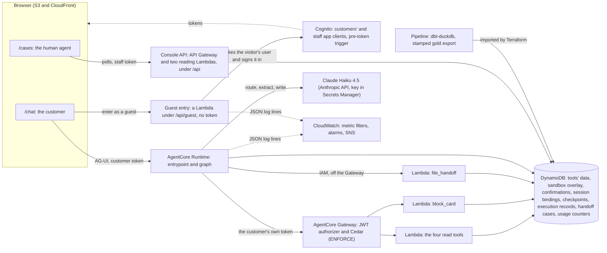
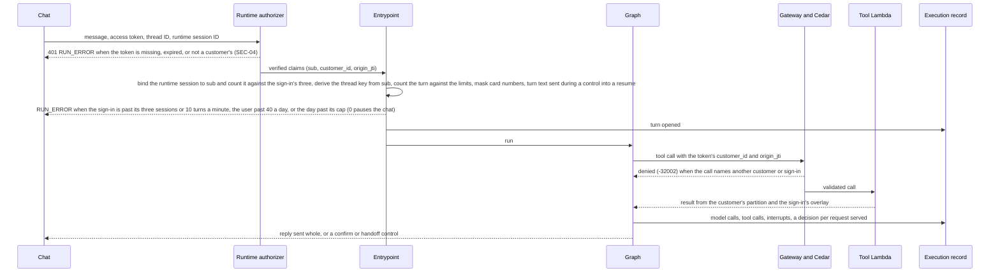
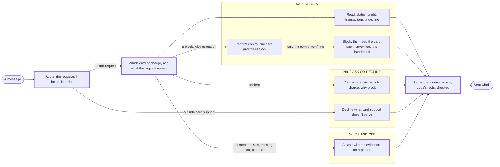
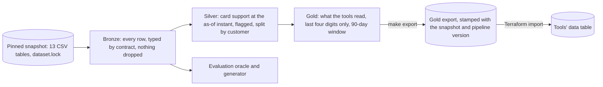
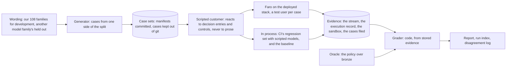

# Architecture

Faro on one page: what runs where, how a turn flows, what the graph decides, where each rule is enforced, how the data reaches the tools, and how we measure the result. Each section names the record that holds the full reasoning. The requirement IDs are from [prerequisites.md](prerequisites.md), and the terms are in the [glossary](glossary.md).

> [!NOTE]
> **As built.** This page describes the deployed prototype. The evaluation's numbers were measured on app stamp `8aa77fa`; the prototype runs that agent with the one post-freeze fix the [report](evaluation/report.md#what-failed-and-why) describes, and with the fixed replies of the limits that bound visitors. Three pieces are designed and not built, each a stated limitation: a handoff filed after a confirmation's deadline when the customer has left ([ADR-0004](adr/0004-agent-architecture-on-agentcore.md#the-confirmation), decision 7); claim and resolve in the console, so every case stays `filed` ([ADR-0007](adr/0007-role-gated-web-app.md#the-console-api)); and the AI team's page, whose report lives in [docs/evaluation/](evaluation/report.md) instead.

## The system

One backend on Amazon Bedrock AgentCore. A Runtime serves the chat and runs an explicit LangGraph workflow. A Gateway exposes Lambda tools under Cedar policies. DynamoDB holds every store. Nothing the model writes reaches a tool's `customer_id`, a confirmation, or a handoff's facts ([ADR-0004](adr/0004-agent-architecture-on-agentcore.md)).

Two layers decide access and actions, and neither trusts the one above it (CTL-04, SEC-05). Cedar checks that every tool call names the customer and the sign-in in the token; each tool checks the rest: the card's status, the confirmation, the window. So the graph can route wrongly without a customer seeing another's records, and the model can answer wrongly without a card being blocked unconfirmed. `file_handoff` stays off the Gateway, since a customer's own token could otherwise file a forged case: the Runtime invokes it with a role no customer holds, and the Lambda checks the token with Cognito and the payload against the execution record before filing.

The site is one static app with a route per role. Customers sign in through one app client and staff through another, and a pre-token trigger refuses a token when the client doesn't match the user's group, and issues a staff token only to a user on the staff allowlist. The console API, under `/api` on the site's own origin, accepts the staff client only and reads cases and the tool calls their evidence names; no console route changes a card. One route beside it takes no token, the guest entry: each click makes a user as a customer drawn from a curated list, counts it against the day's cap on guests, and signs it in through the customers' client; nothing in the request chooses the customer, and a Lambda deletes guests' users a day later ([ADR-0007](adr/0007-role-gated-web-app.md)).

## A turn

The chat opens the runtime session at sign-in with a warm-up the entrypoint answers without running the graph, so the first message doesn't pay the cold start. Each turn has 60 seconds; a model or tool call that fails is tried up to three times, and one that still fails ends the turn with a fixed reply and a person offered (POL-48).

The execution record is the audit log and the evaluation's evidence in one (OPS-02): every model call with its prompt version, tokens, latency, and cost; every tool call with each attempt; every interrupt and resume; and a decision entry per request served, naming the outcome class and what the agent waits for next. It is append-only, and explanations come from it, never from hidden reasoning. Each turn also leaves a trace in CloudWatch (OPS-01): a span for the turn, each node, each model and tool call, and each checkpoint write, under AgentCore's span for the request, so the trace shows where a turn's time goes. A span holds counts, names, and IDs, never a message or a reply, and the turn's record names its trace.

## The graph

A workflow with model steps, not an agent loop (DSN-03, DSN-05). Code chooses every node and tool. The model does five things: it labels a message among eight requests and says whether it holds one at all; it extracts what a card request names, among allowed values; it says which listed transactions fit what the customer said; it writes the words of a read's answer around placeholders; and it writes a handoff's three free-text fields. The calls that read a message also say which language it is mostly in, and code applies POL-50 and POL-51 to that reading. The policy's rules are the router's labels and the nodes' branches ([the policy](policy/card-support.md), CTL-01).

The model takes part only in the steps outlined in purple; the graph node by node is in [ADR-0004](adr/0004-agent-architecture-on-agentcore.md#the-graph).

One message can hold several requests. Code puts them in POL-05's order, serves the first, and keeps the rest: when a request ends on a question or a control, a fixed sentence names what is left, and the turn that answers it serves the rest. Each request served writes its own decision entry.

Three rules make a reply safe to send (AI-03, AI-05, CTL-02):

- **Typed text never confirms.** `confirm` creates a confirmation record and shows a control; only the control's resume, naming that record, confirms or cancels. `block_card` consumes the record in one DynamoDB transaction and reads the card back up to three times. The customer hears "blocked" only when the read-back shows it; otherwise the case is handed off as `action_not_verified`. An offered handoff is filed the same way, only when its control accepts it.
- **Facts as placeholders.** The model writes `{card.expiration}`, never the value; code fills it in the conversation's language and the customer's number format. Outcomes (blocked, verified, a handoff's reference) are fixed sentences chosen by code. The model writes the answer of the four reads only; every question, decline, abstention, refusal, and offer is fixed text.
- **The reply check.** Before a reply leaves, code checks every placeholder, digit, internal flag, and withheld status. A reply that fails is replaced by a fixed one built from the same facts, and the fallback is counted (OPS-05).

The handoff is a structured case, not a transcript (CTL-05): the request, each verified fact tied to the tool call that read it, the actions taken, the customer's own statements kept apart, and the unresolved questions. The graph validates it against [handoff.schema.json](../src/faro/policy/handoff.schema.json); `file_handoff` validates it again, checks each fact against the execution record, adds the `is_fraud` and customer status facts the model never sees, raises the priority to `urgent` where POL-47 requires it, and files it with a reference the customer hears. The console shows the case within a 3-second poll.

## Where each rule holds

| Layer | Decides | Holds even if |
|---|---|---|
| Cognito and the pre-token trigger | Who the customer is; customers get tokens from the customers' app client only, staff from the staff client only and only when on the staff allowlist | The browser is not ours |
| The Runtime's and the Gateway's JWT authorizers | Only a customer's valid token reaches the agent or a tool | The model is fully compromised |
| The entrypoint | The runtime session belongs to the caller; the thread key derives from the verified `sub`; card numbers are masked before anything reads them; turns are limited per sign-in, per user, and for the day, and runtime sessions per sign-in | The client sends another customer's IDs |
| Cedar | Every call names the token's `customer_id` and `origin_jti` | The graph routes wrongly |
| The tools | A read returns the customer's partition and never `is_fraud`; a block needs a confirmed, unexpired confirmation for that card and reason; a handoff's facts must be in the execution record | The graph is wrong |
| The graph | Which card, when to ask, when to abstain, decline, or hand off; the queue, the retries, and the question limit | The model mislabels or misextracts |
| The prompt | Nothing that access or an action depends on | |

The full map, one row per policy rule, is in [ADR-0004](adr/0004-agent-architecture-on-agentcore.md#where-each-rule-is-enforced).

## The data

A batch rebuild per pinned snapshot, on the machine that holds it; only the stamped gold export leaves it ([ADR-0002](adr/0002-mirror-dataset-into-pinned-snapshots.md), [ADR-0006](adr/0006-batch-medallion-pipeline.md); DML-01 to DML-06).

The state the tools read is a frozen master snapshot with an event cutoff: customers and cards as delivered, transactions dated at or before the as-of instant (business date 2026-06-17, read as of 2026-06-18 06:00). Rows updated after that instant are flagged, never corrected, and results are reported with and without them. `prototype` serves export `4a1bc9e15462b739` of snapshot `b3b8b248f604ef9a`; its manifest, with every check's result, is in [docs/pipeline/](pipeline/), and [the pipeline's README](../pipeline/README.md) says how to rebuild it.

Writes never touch the export. A block lands in a sandbox keyed by the sign-in, so each visitor and each evaluation case starts clean. The sandbox also carries the evaluation's fixtures (a record the snapshot lacks) and fault plans (a tool made to fail), honored only in the sign-in that wrote them.

## How we know it works

Offline, on scripted conversations played against the deployed stack and graded by code against an oracle: our own code that applies the policy to the frozen snapshot and shares nothing with the tools ([ADR-0005](adr/0005-offline-scenario-evaluation.md); EVL-01 to EVL-14, DML-07 to DML-12). The [report](evaluation/report.md) reads the results and [results.md](evaluation/results.md) holds every number.

- **The families** ([families.md](evaluation/families.md)): seeds we wrote and paraphrases a model wrote, checked for slots, digits, language, and closeness; team-generated (SEC-02).
- **The split** holds by customer, by the wording's source (ours for development, another model family's held out), and by time (DML-09), with tests that no development artifact holds a held-out customer or message ([ADR-0011](adr/0011-pre-registered-studies.md)).
- **The sets**, with their manifests in [sets/](evaluation/sets/): a regression set of 93 cases that CI plays in process on a team-generated bank, a selection set of 179, the held-out set of 608 drawn once at the freeze, and a second held-out set of 603, sealed for the next agent ([its study](evaluation/studies/held-out-2.md)).
- **The harness** plays a case end to end against the deployed stack: a test user of its own, the chat's own client paced to the usage limits, fixtures and fault plans written under its sign-in, write-once evidence in the evaluation bucket. The unauthorized-access cases call the Gateway's tools directly and expect Cedar to deny them.
- **The grader** is a function of the case and its stored evidence, so a later version regrades without running the system. Where Faro and the oracle disagree, the question goes to the [disagreement log](evaluation/disagreements.md), and CI's regression gate lets a finding through only while an open entry matches it.
- **The baseline** is the same graph with a keyword router, pattern extraction, and templated replies, so no model runs; it played the same held-out cases once (EVL-01).
- **No model judges.** The submission's measurement had a judge, Claude Opus 5.5, for wording, validated against our blind hand grades on 136 replies; one question of nine met the bar (EVL-10). It was dropped after the submission, and code now checks the form of address and the words a reply may not use ([ADR-0011](adr/0011-pre-registered-studies.md)).
- **The tests** ([tests/README.md](../tests/README.md)) check what must hold on every turn, apart from how well the agent does: each thing we expect a visitor to try, from another customer's number to a typed yes, has an integration test against a deployed stack.
